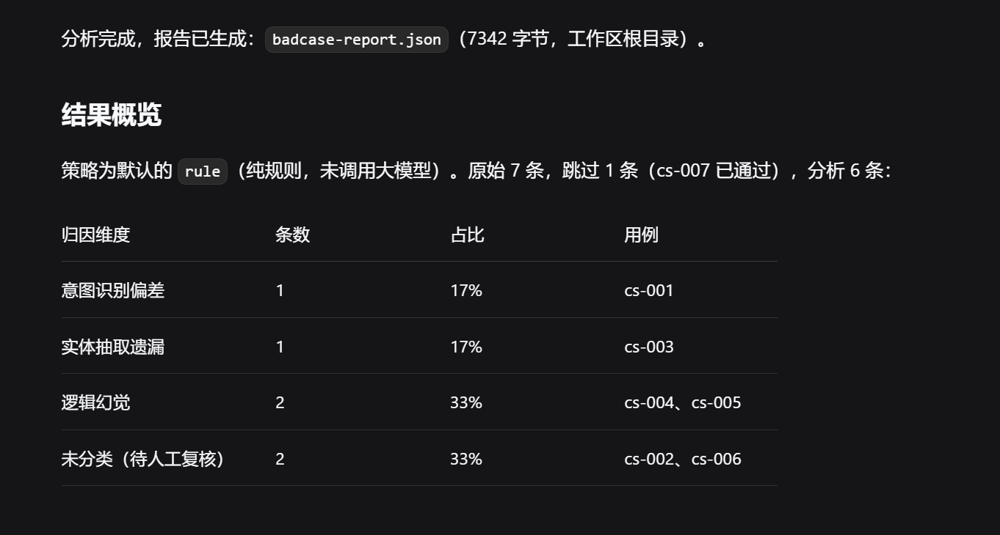
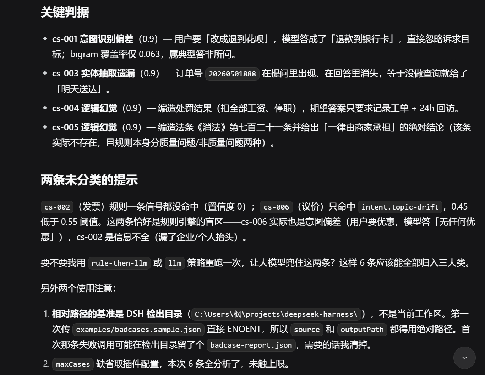

<div align="center">

# dsh-badcase-analyzer

**给 DeepSeek Harness 的评测结果装上「归因能力」**
把 Bad Case 自动分成三大类，输出可跨批次对比的结构化 JSON 报告。

[](https://github.com/deepseek-ai/deepseek-harness)
[](https://github.com/Lmoh1/dsh-badcase-analyzer/actions/workflows/ci.yml)
[](https://nodejs.org)
[](#开发与验证)
[](#开发与验证)
[](./LICENSE)

规则引擎兜底 · LLM 补刀 · 每条结论都带判据 · **零 API Key 可自测**

</div>

---

## 目录

- [为什么需要它](#为什么需要它)
- [核心特性](#核心特性)
- [快速开始](#快速开始)
- [运行效果](#运行效果)
- [归因逻辑](#归因逻辑)
- [输入与输出契约](#输入与输出契约)
- [目录结构](#目录结构)
- [开发与验证](#开发与验证)
- [设计取舍](#设计取舍)
- [已知限制](#已知限制)
- [路线图](#路线图)

## 为什么需要它

评测报告只回答一个问题：「**通过率是多少**」。它不回答团队真正要排期的问题：

> 这批 Bad Case 到底**错在哪一环**？是没听懂需求、漏了关键信息，还是编造了事实？

人工处理通常是这样：一条条读「问题 + 模型回答 + 期望答案」→ 心里贴个标签 → 汇总成一张分布表 → 写进周报和下一个迭代。**这也是最重复劳动的环节。**

本插件把这个流程收成一次工具调用：

```
评测结果 JSON ──▶ badcase_analyze ──▶ 每条归因 + 判据 + 改进建议
                        │
                        └──▶ 结构化 JSON 报告（可入库 / 可对比 / 可直接喂给 Agent）
```

分类维度**固定三个**，刻意不做成可配置项——只有维度固定，不同批次、不同人的报告才能横向对比：

| key | 中文标签 | 典型表现 |
| --- | --- | --- |
| `intent_misunderstanding` | 意图识别偏差 | 答非所问、多轮上下文丢失、忽略「改成 / 换成 X」这类目标变更 |
| `entity_omission` | 实体抽取遗漏 | 漏掉订单号、时间、金额、联系方式、商品名，答案空泛不可执行 |
| `logic_hallucination` | 逻辑幻觉 | 编造法条编号、政策条款、处罚动作、物流状态、赔偿承诺 |

## 核心特性

### Rule-then-LLM 双引擎

不是「规则 or LLM」的二选一，而是三种策略共用一个入口：

| 策略 | 行为 | 成本 | 适用场景 |
| --- | --- | --- | --- |
| `rule` | 只跑关键词 + 启发式规则，分数低于阈值即标 `unclassified` | **0 成本**、结果可复现 | 每次提交后的快速回归、离线分析 |
| `llm` | 只跑大模型，按三个维度做判定 | 每条一次调用 | 追求召回，愿意付 token |
| `rule-then-llm` | 规则有把握直接用，**没把握才交给 LLM** | 折中 | 默认推荐 |

样例数据上的实测：6 条失败用例里，规则独立定类 4 条，只把 2 条真正拿不准的发给模型 —— **省掉约 2/3 的调用，同时不留死角**。

### 高可解释性

每条结论都带三样东西，而不是只有一个标签：

- **判据（`evidence`）**：命中的具体规则 id + 人话理由，例如
  `[intent.ignored-target] 问题要求「改成/换成 退到花呗」，回答没有接住这个目标`；
- **置信度（`confidence`）**：规则引擎上限 0.9（启发式不该自称"近乎确定"），LLM 自评后夹到 `[0,1]`；
- **改进建议（`suggestion`）**：落到数据 / 提示词 / 检索 / 后处理的具体动作，而不是"建议优化模型"。

同时**规则拿不准就承认拿不准**：分数低于 `rules.confidenceThreshold`（默认 0.55）一律落 `unclassified`。宁可不给结论，也不要给出错标签污染统计口径。

### 卡片式渲染

- 对话里直接看到**汇总**（各类占比 + 失败明细 + 判据），不用再翻报告文件；
- `output.presentationMeta` 把汇总数字持久化到 `tool/result` 的 `meta`，**可回放**；
- 模型看到精简文本，程序（PTC mode / 下游脚本）拿到完整 JSON —— 同一份数据、两种投影。

> 真正的自定义视觉卡片需要独立的客户端插件（`dsh.client` + `tool.call.toolview` 插槽），属于路线图中的 Phase B；当前 Phase A 走通用工具卡片 + 结构化投影，数据形状已按其所需设计好。

### 契约严格，机器可读

- 工具的 `parameters` 与 `output.schema` 都由 DSH 的 schema DSL 声明，注册表会**双向校验**（入参与返回值）；
- 输出根对象 `additionalProperties: false` —— 字段多一个少一个都会在运行时暴露，而不是悄悄漂移；
- 报告带 `reportVersion`，结构升级时下游可按版本解析历史数据。

### 零成本自测

`llm.ts` 只依赖一个结构化依赖 `LlmStreamer`（只有 `stream()` 一个方法），所以测试能注入**假 LLM 流**：

```bash
pnpm test                    # 85 个单测：不需要 API Key，不需要起 DSH
pnpm build && pnpm smoke     # 34 项契约断言：跑的是构建产物 lib/
```

单测覆盖规则引擎的定性/阈值/平票、LLM 的解析与重试、三策略编排与降级、输入归一化的跳过原因、
工具两套 schema 与卡片投影；冒烟脚本再对 `lib/` 产物做一遍端到端验证。两者都不花钱，
fork 来的 PR 也能跑满。

### 不挑数据格式

不同评测框架字段名各异，插件内部做归一化，**不需要你改数据**：

- 输入可以是 JSON 文件路径 / Case 数组 / 评测报告对象（自动探测 `results` `cases` `items` `data` `samples` `records`）；
- 字段别名：`id | caseId | case_id`、`answer | output | response | prediction`、`groundTruth | reference | gold` 等；
- `pass / passed / success` 为真的用例自动跳过，但仍计入 `skipped` 统计。

## 快速开始

### 0. 前置条件

- Node.js `^22.19` 或 `>= 24`
- 一份可运行的 [DeepSeek Harness](https://github.com/deepseek-ai/deepseek-harness) 检出（从源码运行时用 `pnpm dsh ...` 启动）

### 1. 装依赖并构建

```bash
git clone https://github.com/Lmoh1/dsh-badcase-analyzer.git
cd dsh-badcase-analyzer
pnpm install
pnpm build          # src → lib（同时产出 .d.ts）
```

### 2. 配置 `cordis.local.yml`

仓库根目录已经带了一份可直接用的 `cordis.local.yml`，**正常情况下不需要改**：

```yaml
- insert:
    - id: badcase-analyzer-dev
      name: './src/index.ts'      # 相对本文件所在目录；也可写 './lib/index.js'
      config:
        strategy: rule            # rule | llm | rule-then-llm
        report:
          writeFile: false        # 开发期不落盘；要看 JSON 报告就改 true
```

路径规则（已在 DSH 源码 `packages/boot/app-boot` 的 `anchorInsertedPluginNames` 中核实）：

| 写法 | 解析方式 | 用在哪 |
| --- | --- | --- |
| `./src/index.ts`、`../lib/index.js` | 转成 `file://` URL，**基准是 yml 文件所在目录** | 推荐：跨机器可移植，可提交 |
| `/abs/path/src/index.ts` | 绝对路径 | 写进 `~/.dsh/profiles/<name>/cordis.patch.yml` 时必须这样写 |
| `dsh-badcase-analyzer` | 裸包名 → Node 从 profile 目录向上解析 | 仅用于**组合包** `cordis.patch.yml` |

> YAML 小坑：路径含空格要加引号；双引号里 `\` 是转义符，请用正斜杠或单引号。

### 3. 启动

```bash
cd /path/to/deepseek-harness
pnpm dsh web --patch "/path/to/dsh-badcase-analyzer/cordis.local.yml"
```

打开终端提示的 URL（通常是 `http://127.0.0.1:3080`）。

想先确认配置层被正确识别、不启动服务：

```bash
pnpm dsh --profile web --patch "/path/to/dsh-badcase-analyzer/cordis.local.yml" --dump-config
```

> **热加载方式**：若你的 profile 是 `patchReload: live`，把上面那段 `insert` 写进
> `~/.dsh/profiles/<name>/cordis.patch.yml`（`name` 必须用绝对路径），保存即生效，无需重启。

### 4. 触发分析

在会话里直接说：

```
用 badcase_analyze 工具分析 "/path/to/dsh-badcase-analyzer/examples/badcases.sample.json"
```

> 相对路径是相对 **DSH 进程的工作目录**（也就是启动目录），不是插件仓库。想省事就用绝对路径。

也支持直接贴数组，或只分析指定用例：

```
用 badcase_analyze 分析这批 case，只跑 cs-003 和 cs-007，并把报告写到 ./reports/
```

### 5. 常用配置

```yaml
config:
  strategy: rule-then-llm      # 默认 rule
  maxCases: 200                # 单次最多分析多少条，防止打爆上下文
  llm:
    provider: deepseek-official
    model: deepseek-v4-flash
    temperature: 0             # 归因要可复现，默认 0
    maxOutputTokens: 1024
    timeoutMs: 30000
    fallbackToRules: true      # LLM 失败时回退规则结论，而不是整批失败
  rules:
    confidenceThreshold: 0.55  # 低于此分数 → 未分类（交给 LLM 或人工）
    extraKeywords:             # 业务词表：key 支持类别 key 或中文标签
      逻辑幻觉: ['内测资格', '免费终身']
  report:
    writeFile: true
    outputPath: ./badcase-report.json
    includeEvidence: true      # 对话文本里是否显示判据
    maxDetailLines: 20         # 文本里最多展开几条明细（完整明细在 JSON 里）
```

## 运行效果

在会话里让模型调用 `badcase_analyze`，会直接得到一份汇总表（数字来自工具返回值的 `summary.byCategory`）：

<p align="center">
  
</p>

每条结论都带判据 —— 能看出"这条到底错在哪一步"，而不是只贴一个标签：

<p align="center">
  
</p>

对话里拿到的汇总（样例数据，`strategy: rule`）：

```text
# Bad Case 归因分析报告（策略：rule）

共分析 6 条失败用例：意图识别偏差 1 条（17%） ｜ 实体抽取遗漏 1 条（17%）
｜ 逻辑幻觉 2 条（33%） ｜ 未分类 2 条
跳过 1 条（已通过 / 字段缺失 / 超上限 / 被 caseIds 过滤）｜原始条目 7 条｜来源：examples/badcases.sample.json

## 明细（前 6 条，完整明细见 JSON 报告的 cases 字段）
1. [cs-001] 意图识别偏差（置信度 0.9，来源 rule）
   问：帮我把上周买的耳机退款，改成退到花呗
   答：好的，已为您取消订单并全额退款到银行卡，预计 3 个工作日到账。
   判据：[intent.ignored-target] 问题要求「改成/换成 退到花呗」，回答没有接住这个目标
   建议：命中信号「intent.ignored-target」… 建议：把这类意图做成评测样本回灌…
```

程序侧拿到的是完整 JSON（节选）：

```jsonc
{
  "reportVersion": "1.0.0",
  "strategy": "rule",
  "source": { "kind": "file", "label": "…/examples/badcases.sample.json", "total": 7 },
  "summary": {
    "total": 6, "analyzed": 6, "skipped": 1, "unclassified": 2,
    "byCategory": [
      { "key": "intent_misunderstanding", "label": "意图识别偏差", "count": 1, "ratio": 0.167 },
      { "key": "entity_omission",         "label": "实体抽取遗漏", "count": 1, "ratio": 0.167 },
      { "key": "logic_hallucination",     "label": "逻辑幻觉",     "count": 2, "ratio": 0.333 }
    ]
  },
  "cases": [
    {
      "caseId": "cs-005",
      "question": "退货运费谁承担？",
      "modelAnswer": "根据《消费者权益保护法》第七百二十一条，退货运费一律由商家承担。",
      "category": "logic_hallucination",
      "categoryLabel": "逻辑幻觉",
      "confidence": 0.9,
      "method": "rule",
      "evidence": [
        "[hallucination.legal-citation] 回答引用了期望答案中没有的法律依据：《消费者权益保护法》、第七百二十一条",
        "[hallucination.absolute-assertion] 回答使用绝对化断言（一律），期望答案中没有对应的绝对表述"
      ],
      "suggestion": "…政策/法条/售后规则类问题强制走检索（RAG），并在回答里给出出处…"
    }
  ]
}
```

## 归因逻辑

### 规则引擎：多维打分，不是 `if-else` 短路

三个维度**各积累分数**，最后取最高分；同分按严重度取（幻觉 > 实体 > 意图）。这样一条规则命中不会遮住其它信号，也方便后续按真实数据校准权重。

| 维度 | 规则 id | 权重 | 判定 |
| --- | --- | --- | --- |
| 逻辑幻觉 | `hallucination.legal-citation` | 0.55 | 引用《…》/ 第 N 条，期望答案无法律依据 |
| 逻辑幻觉 | `hallucination.punitive-action` | 0.5 | 声称已扣工资 / 停职 / 封号 / 十倍赔偿 |
| 逻辑幻觉 | `hallucination.absolute-assertion` | 0.45 | 一定 / 一律 / 全部 / 永久…，期望答案无对应表述 |
| 逻辑幻觉 | `hallucination.number-conflict` | 0.55 | 期望里的关键数字，回答给了另一套 |
| 逻辑幻觉 | `hallucination.extra-quantity` | 0.3 | 问题与期望都没提供，回答却给出带单位的具体数量 |
| 实体抽取遗漏 | `entity.missing-question-slot` | 0.6 | 问题里的强实体（单号 / 长数字 / 手机号 / 邮箱 / 引号内容）在回答中消失 |
| 实体抽取遗漏 | `entity.missing-expected-slot` | 0.5 | 期望里的强实体在回答中缺失 |
| 实体抽取遗漏 | `entity.missing-time` / `.missing-quantity` / `.missing-contact` | 0.4 ~ 0.5 | 问时间 / 金额 / 联系方式，回答里没有对应信息 |
| 实体抽取遗漏 | `entity.answer-too-short` | 0.35 | 回答过短，覆盖不了问题 |
| 意图识别偏差 | `intent.ignored-target` | 0.55 | 「改成 / 换成 X」但回答里没有 X |
| 意图识别偏差 | `intent.unaddressed-<诉求族>` | 0.5 | 问了某类诉求（退款 / 发票 / 物流 / 投诉 / 价格…），回答零回应 |
| 意图识别偏差 | `intent.topic-drift` | 0.45 | 回答与问题 bigram 覆盖率 < 0.08 |
| 意图识别偏差 | `intent.negation-flip` | 0.5 | 问题是否定 / 禁止，回答给了硬性肯定 |
| 自定义 | `custom.<category>` | 0.4 | 命中 `rules.extraKeywords` 业务词表 |

### LLM 引擎：先约束输出，再严格校验

- 走 DSH 官方服务 `ctx.llm.stream({ provider, model, system, messages, temperature, maxTokens, signal })`；
- 系统提示词写死：三个类别定义、判定顺序（**方向 → 实体 → 事实**）、平票规则、JSON 输出契约；
- 解析侧严格校验：类别必须是三个 key（也接受中文标签）、`confidence` 夹到 `[0,1]`、`evidence` 只留字符串；
- 首次输出不是 JSON → **自动重试一次**并追加强约束；仍失败则抛带错误码的 `LlmAttributionError`。

| 错误码 | 含义 | 上层处理 |
| --- | --- | --- |
| `LLM_CALL_FAILED` | 调用失败 / 被中止 | 回退规则结论（`fallbackToRules`） |
| `LLM_EMPTY_REPLY` | 空回复 | 重试 → 仍失败则回退 |
| `LLM_TRUNCATED` | 输出被 `max-tokens` 截断 | 提示调大 `maxOutputTokens` |
| `LLM_BAD_JSON` | 不是合法 JSON | 重试一次 |
| `LLM_BAD_CATEGORY` | 类别不在三大类内 | 重试 / 回退 |

**单条失败不影响整批**：降级时保留该条的规则结论，并把失败原因写进 `evidence`，报告里能看出「这条其实没问成模型」。

## 输入与输出契约

### 输入

`source` 支持三种形态，工具参数用 `oneOf` 表达为「恰好匹配一支」：

```jsonc
// ① 文件路径
{ "source": "examples/badcases.sample.json" }

// ② 内联数组
{ "source": [{ "caseId": "cs-1", "question": "…", "modelAnswer": "…", "pass": false }] }
```

评测报告对象（③）也可以直接丢进文件：自动探测 `results` / `cases` / `items` / `data` / `samples` / `records`。

| 规范字段 | 可接受别名 | 说明 |
| --- | --- | --- |
| `caseId` | `id` / `case_id` / `sampleId` | 缺失时用 `case-<序号>` 兜底 |
| `question` | `query` / `input` / `prompt` | 必填 |
| `modelAnswer` | `answer` / `output` / `response` / `prediction` | 必填 |
| `expected` | `groundTruth` / `reference` / `gold` | 可选；有它才能判断「该有的实体有没有」 |
| `pass` | `passed` / `success` / `status` | 缺省视为失败（只分析 Bad Case） |
| `tags` | `labels` / `categories` | 可选，透传到报告便于切片 |

### 输出

根对象严格（`additionalProperties: false`），字段既供人读也供程序消费：

| 字段 | 说明 |
| --- | --- |
| `reportVersion` | 报告 schema 版本 |
| `generatedAt` | ISO 8601 生成时间 |
| `strategy` | 本次实际使用的策略 |
| `source` | `{ kind: 'file' \| 'inline', label, total }`，`total` 是含通过用例的原始条目数 |
| `summary` | `total` / `analyzed` / `skipped` / `unclassified` / `byCategory[]`（固定三维度、固定顺序、带 `ratio`） |
| `reportPath` | 报告落盘路径（`writeFile: false` 时该字段不存在） |
| `cases[]` | 逐条：`caseId` / `question` / `modelAnswer` / `expected?` / `tags?` / `category` / `categoryLabel` / `confidence` / `method` / `evidence[]` / `suggestion` |

`method` 标明归因来源：`rule`（规则）/ `llm`（模型）/ `fallback`（LLM 失败后回退规则）。

## 目录结构

```
dsh-badcase-analyzer/
├── package.json              # 包元数据 + dsh.bundle manifest + peerDependencies
├── tsconfig.json             # 构建：src → lib（.js + .d.ts）
├── tsconfig.test.json        # 类型检查：src + tests（noEmit）
├── vitest.config.ts          # 测试配置
├── cordis.patch.yml          # 组合包层（按包名引用，发布 / 安装用）
├── cordis.local.yml          # 本地开发 --patch 覆盖层（相对路径，可直接用）
├── .github/workflows/ci.yml  # CI：类型 → 构建 → 单测 → 契约冒烟（Node 22 / 24 矩阵）
├── examples/
│   └── badcases.sample.json  # 输入契约的可执行样例（6 条失败 + 1 条通过）
├── scripts/
│   └── smoke.mjs             # 无需 DSH / 无需 API Key 的端到端自检（34 断言）
├── src/
│   ├── index.ts              # 插件入口：name / inject / Config / apply
│   ├── config.ts             # Schemastery 配置 schema
│   ├── attribution/          # 归因层（不反向依赖工具层，可单独 import）
│   │   ├── types.ts          # 三维度定义、数据模型、策略枚举
│   │   ├── rules.ts          # 规则引擎（多维打分）
│   │   ├── llm.ts            # LLM 归因（Prompt + 解析 + 重试）
│   │   └── index.ts          # 编排：rule / llm / rule-then-llm + 降级
│   └── tool/
│       └── badcase-analyze.ts# defineTool('badcase_analyze')：契约 / 归一化 / 报告 / 卡片
├── docs/images/              # README 截图
└── tests/                    # 85 个单测（vitest）
    ├── support/fakes.ts      # 假 LLM 流 + 夹具（结构化依赖的收益）
    ├── rules.spec.ts         # 规则引擎：定性、阈值、平票、自定义词表
    ├── llm.spec.ts           # Prompt、JSON 解析、重试、截断、中止
    ├── attribution.spec.ts   # 三策略编排与失败降级
    ├── load-cases.spec.ts    # 输入归一化：别名、跳过、截断、错误
    └── tool.spec.ts          # 工具契约：schema、执行、落盘、卡片投影
```

## 开发与验证

```bash
pnpm typecheck      # 类型检查 src + tests（不含 emit）
pnpm test           # 85 个单测（vitest）
pnpm test:coverage  # 单测 + v8 覆盖率
pnpm build          # src → lib
pnpm smoke          # 契约冒烟：34 项断言，不花钱、不起 DSH
pnpm verify         # 上面四步串起来跑（CI 用同一套命令）
```

### 单测覆盖了什么

| 文件 | 关注点 |
| --- | --- |
| `tests/rules.spec.ts` | 三个维度各自能否定性；分数低于阈值必须落 `unclassified`；同分按严重度取；自定义词表支持类别 key 与中文标签；判定是纯函数（同输入同输出） |
| `tests/llm.spec.ts` | 提示词是否真带上了用例三元组；JSON 解析的宽容性（代码块 / 废话 / 中文标签）与严格性（越界夹取、非法类别、非 JSON）；重试只重试一次；截断与中止的报错码 |
| `tests/attribution.spec.ts` | 三种策略的调用次数（`rule-then-llm` 只把没把握的交给模型）；LLM 失败的回退与关闭回退两种行为；输出顺序稳定 |
| `tests/load-cases.spec.ts` | 字段别名归一化；`pass` 的多种写法；跳过原因可追溯；`maxCases` / `caseIds`；非法 JSON 与找不到数组时**响亮失败** |
| `tests/tool.spec.ts` | 参数/输出两套 schema 用 DSH 自带校验器验证；`output.schema` 严格性（多一个字段就校验不过）；报告落盘内容一致；`presentationMeta` / `presentCall` / `presentResult` 的形状与回退 |

单测用**假 LLM 流**替换 `ctx.llm`：归因层只依赖 `LlmStreamer`（一个 `stream()` 方法），
所以不需要真 API Key、不需要起 DSH，PR 里也能跑满。

### 契约冒烟（`pnpm smoke`）

跑构建产物 `lib/`，依次验证：配置默认值与非法配置拒绝 → 两套 schema 合法 → 样例逐条归因 →
LLM 策略（假流）→ LLM 失败降级 → `rule-then-llm` 调用次数 → JSON 重试 / 非法类别 / 截断 →
渲染与卡片投影 → 内联输入与 `caseIds` 过滤。**它比单测更"端到端"**：单测跑 `src`，它跑 `lib`，
能顺带发现构建产物路径/导出问题。

> 在受限沙箱（禁止 spawn 子进程）里跑单测会报 `spawn EPERM`，用
> `vitest run --pool=threads` 绕过即可；普通开发机与 CI 用默认的 `forks` 池。

### 从本地 DSH 检出开发

如果 npm 上装不到与检出匹配的 `@deepseek-ai/*` 版本，可以把依赖直接链到本地检出
（好处：与宿主共用同一份物理文件，不会出现两份 `@deepseek-ai/dsh-tools`）：

```bash
pnpm add -D link:/path/to/deepseek-harness/packages/core/tools \
            link:/path/to/deepseek-harness/packages/llm/llm \
            link:/path/to/deepseek-harness/vendor/cordis \
            link:/path/to/deepseek-harness/vendor/schemastery
```

> 别把带本机绝对路径的 `link:` 提交上去——发布前恢复成版本号区间。

### Windows 提示

若 PowerShell 报 `pnpm.ps1 cannot be loaded ... not digitally signed`（执行策略拦截了 `.ps1` shim），
改用 `pnpm.cmd xxx` 或 `cmd /c pnpm xxx` 即可，不需要改系统策略。

## 设计取舍

几个刻意的选择，也是这个插件最值得讨论的地方：

1. **阈值优先于命中率**：规则分数不够就输出 `unclassified`，而不是硬塞一个最相近的类别。
   归因报告的价值在于可信；一个错标签会污染整批统计，而人工复查的那点时间远比省下的自动化便宜。
2. **规则优先，而不是 LLM 优先**：规则可复现、可解释、零成本，天然适合作回归基线；LLM 只处理规则覆盖不到的角落。
   反过来（LLM 优先）会把成本与不确定性放到每次跑评测的必经路径上。
3. **置信度上限 0.9**：启发式规则不该自称"近乎确定"。数字要能被下游当权重用，就不能虚高。
4. **一条用例失败不拖垮整批**：LLM 调用失败按条降级，报告照出，失败原因写进判据——
   "报告里缺一条"远比"整批失败"更难排查。
5. **分类维度不做成配置项**：维度可配置看起来更灵活，实际会让跨批次对比失效。

## 已知限制

- 规则引擎是关键词 + 启发式，召回有上限：样例 6 条里有 2 条（发票要素不全、议价线索忽略）
  给不出高置信结论 → 落 `unclassified`。这正是 `rule-then-llm` 要补的部分，不是 bug。
- 未引入中文分词依赖，实体识别走正则白名单（单号 / 金额 / 时间 / 联系方式 / 引号内容），
  对"人名、商品名"这类无固定形态的实体识别较弱。
- `bigram` 字面重合度对「同义不同词」会误判（问"能不能便宜点"、答"价格是固定的"），
  因此该规则权重压在阈值附近，单独命中不足以定类。
- DSH API 仍在快速迭代，本包对 `@deepseek-ai/*` 采用宽松 peer 区间；
  所有依赖内部细节的位置都有 `// TODO` 标注，升级 DSH 后请先跑 `pnpm smoke`。
- 真正的自定义视觉卡片需要客户端插件（`dsh.client` + `tool.call.toolview` 插槽），当前走通用卡片 + 结构化投影。

## 路线图

- [x] 插件骨架：目录结构、`dsh.bundle` manifest、`package.json`
- [x] 工具契约：`defineTool('badcase_analyze')` + `Config` + 输入归一化 + 报告 / 渲染 / 卡片投影
- [x] 归因逻辑：规则引擎 + LLM Prompt + 三策略编排 + 失败降级
- [x] 端到端自检：34 项断言（免 DSH、免 API Key）
- [x] 单测：85 个 vitest 用例 + v8 覆盖率
- [x] CI：GitHub Actions（Node 22 / 24 矩阵：类型 → 构建 → 单测 → 冒烟）
- [ ] Phase B：自定义 WebUI 卡片（客户端插件）
- [ ] 批量并发调用与成本统计（按 `method` / token 汇总）
- [ ] 提交 `pnpm-lock.yaml` 后开启 CI 依赖缓存与 `--frozen-lockfile`

## License

[MIT](./LICENSE)
